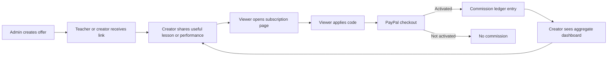

# Polymath Musician: low-cash growth operating system

## Outcome

Polymath can recruit teachers, composers, musicians, and small creators without paying an upfront sponsorship fee. A partner receives a unique link and code. The customer receives an administrator-configured subscription benefit. The partner earns an administrator-configured commission only after PayPal confirms that the subscription activated.

This is low-upfront-cash distribution, not free distribution. Cash-out-eligible Mcoins are a financial liability. Treat customer discount + creator commission + payment fees + support costs as customer-acquisition cost.

## Two-campaign autopilot

The administrator marketing page now keeps the launch deliberately narrow:

1. **Founding teacher partners** — unique 10% customer / 10% creator offers, paid only after verified subscription activation.
2. **Playable song proof** — a rights-cleared, human-verified 15–30 second result that a visitor can hear, try, score, and share.

The autopilot reads the selected 7-, 30-, or 90-day evidence window and assigns each experiment one decision: set up, fix quality, collect evidence, repair, hold, or scale. It also prepares the corresponding admin form and copies a compliant content brief. It never contacts creators, publishes a song, or spends money automatically.

The default planning ceiling is USD 500. Automatic spend is always USD 0. The dashboard reserves 20% for proof/QA, 20% for a capped challenge or teacher pilot, and 60% for the single experiment that first clears its scale gate. If both clear the gate, the experiment with more verified activations wins; activation rate breaks a tie. This ceiling is not an external accounting ledger: promotion redemption caps are the enforceable liability guardrail, and the administrator must reconcile processor charges and offline expenses.

## The loop



The system records five distinct facts:

1. Referral link opened — a browser-reported interest signal.
2. Code claimed — a signed-in account selected the offer.
3. Checkout started — the server created or reused a PayPal checkout.
4. Subscription activated — PayPal confirmation or webhook granted access.
5. Commission paid — an idempotent server transaction credited the linked creator.

Only stages 4 and 5 are trusted revenue events. Browser events cannot manufacture a commission.

## What engineering delivered

| Need from marketing | Engineering behavior |
|---|---|
| Give the customer a percentage discount | `subscription_percent` code; price is overridden in PayPal checkout |
| Give the customer a fixed benefit | `subscription_fixed`; 1 Mcoin equals $1 USD and checkout cannot fall below $0.01 |
| Pay 10% commission | Percentage is calculated from the actual discounted checkout price, rounded to two decimals |
| Offer a flat bounty | Fixed Mcoin commission remains available |
| No payment for fake clicks | Commission is called only on first verified subscription activation |
| Stop self-referrals | A creator cannot claim a code connected to their own account |
| Stop duplicate commission | One buyer/promotion conversion can pay only once; webhook and confirmation paths are idempotent |
| Let existing users use creator links | Codes can be applied at checkout, not only during registration |
| Make sharing simple | Admin and creator can copy the disclosure plus direct `#payment?promo=CODE` link |
| Give creators proof | Account dashboard shows 30-day visits/checkouts, claims, pending conversions, paid conversions, and Mcoins earned |
| Protect customer privacy | Creator dashboard exposes aggregate counts, never buyer email, phone, name, or identity |
| Keep cash-out controlled | The configured cash-out fee, limits, and administrator review apply to every request |
| Turn teachers into distribution | Any teacher account can be assigned a referral program; the existing private lesson system provides calls, invitations, WebRTC signaling, 10-minute billing steps, breakout rooms, and Mcoin transfers |

## Administrator workflow

1. Open **Admin → Marketing**.
2. Choose a subscription percentage or fixed-Mcoin offer.
3. Search for the exact creator by name, email, phone, or Friend ID.
4. Choose percentage commission or fixed commission.
5. Review the live $14.99 example. It shows customer price, creator commission, and the amount retained before payment fees.
6. Set start/end dates and redemption caps for a test campaign.
7. Create the code.
8. Copy the disclosure and referral link.
9. Give the creator one concrete content brief; do not ask for a generic advertisement.
10. Review visits → claims → checkout → paid conversions weekly. Pause weak offers; expand proven ones.

## The first offer to test

Do not begin with twenty offers. Use one clean experiment:

- Audience: small piano teachers and piano-cover creators whose viewers ask for sheets or tutorials.
- Customer benefit: 10% off. Use 20% only for a short launch window.
- Creator commission: 10% of the actual paid checkout.
- Content: creator demonstrates one recognizable 15–30 second section, then shows the same section becoming playable inside Polymath.
- Call to action: “Try this exact song with my code.”
- Test size: 10 creators, not 100 simultaneous cold relationships.
- Success gate: at least 100 qualified link visitors before judging conversion.

Example with Musician monthly at $14.99:

```text
Customer discount (10%)    = $1.50
Customer pays              = $13.49
Creator commission (10%)   = 1.35 Mcoins
Polymath before fees/costs  = $12.14
```

The admin preview is authoritative for the configured offer. Payment-processor fees, refunds, taxes, infrastructure, and support still come out of the retained amount.

## Highest-leverage low-cash channels

### 1. Teacher-led referrals

Teachers already have trust and a recurring reason to send students to a tool. Give each teacher a code and a ready-to-teach song link. They earn from the subscription and may also earn from their human lessons. The pitch is not “advertise our software”; it is “use this to save preparation time and give students a practice tool between lessons.”

### 2. Composer and arranger referrals

Let a composer publish a playable arrangement, share a short preview, and earn from both sheet commerce and referred subscriptions. Their content is the demonstration, so marketing material is also product value.

### 3. Outcome-based creator videos

Pay no upfront fee during the test. Offer tracked commission and provide a specific video concept:

- original song → Polymath piano result;
- “learn this chorus in 60 seconds”;
- phone versus desktop playability test;
- PDF/MIDI upload → playable keys;
- teacher creates a private virtual lesson and breakout room.

Creators should disclose the commercial relationship clearly in the video/post, not bury it behind “more.” The FTC treats money, free access, discounts, and other value as material connections that viewers should understand.

### 4. Student win sharing

After a measurable practice result, generate a lightweight share card or playable excerpt with the song, score, and a direct invitation. The current artist-campaign and learning-win infrastructure can support this loop. Never expose private uploads by default.

### 5. School pilot through one champion

Do not cold-sell an entire school first. Recruit one teacher champion, provide a small class pilot, measure activation and repeated practice, then use those results for the institution buyer. A champion referral can be credited to the teacher without exposing student identities.

### 6. Community and lesson loop

Student discovers a teacher → private chat → paid lesson → practice with a playable sheet → visible improvement → teacher shares another song. Calls are a retention system, not only a separate feature.

## Funnel diagnosis

| Signal | Likely problem | Marketing or engineering response |
|---|---|---|
| Few visits | Weak creator/content distribution | Change creator, hook, thumbnail, or content format |
| Visits but few claims | Benefit or landing page is unclear | Tighten first screen and offer wording |
| Claims but few checkouts | Price/trust mismatch | Improve proof, price framing, and checkout CTA |
| Checkouts but few activations | Payment/configuration failure or purchase anxiety | Inspect PayPal errors and trust copy |
| Activations but poor retention | Product outcome is weak | Improve transcription/playback quality before buying more reach |
| High support demand | Onboarding is unclear | Fix the first-run flow; do not hide the problem with more ads |

## Anti-fraud and money rules

- Never pay commission from a browser event.
- Never expose referred-user identity to the creator.
- Block self-referrals.
- Pay a buyer/promotion pair once.
- Store the exact customer price and commission on the subscription record.
- Keep ledger entries for creator credit and platform marketing cost.
- Require administrator review for cash-out.
- The current product permits regular accounts to request cash-out from their wallet balance and applies the configured fee. Treat promotional Mcoins as a real liability.
- Before large-scale cash payouts, add a configurable commission hold plus refund/chargeback reversal. A 30–60 day hold is safer than immediate withdrawal.
- Cap redemptions on experiments so a typo cannot create unlimited liability.

## Compliance baseline

- The FTC requires material creator-brand relationships to be disclosed clearly and conspicuously: <https://www.ftc.gov/news-events/topics/truth-advertising/advertisement-endorsements>
- FTC endorsement FAQs explain that disclosures should travel with the endorsement: <https://www.ftc.gov/business-guidance/resources/ftcs-endorsement-guides-what-people-are-asking>
- YouTube also requires paid-promotion disclosure and explains that affiliate commissions may be adjusted for returned purchases: <https://support.google.com/youtube/answer/13376398?hl=en>

The product copies a plain disclosure with every referral link: “I may earn Mcoins if you subscribe through code CODE.” The creator may add personality, but must not remove the meaning.

## 30-day rollout

### Week 1 — proof

- Pick one high-quality piano transformation that is safe to publish.
- Create one 10% customer / 10% creator code per creator.
- Onboard three teachers and three small creators manually.
- Test links, discount, PayPal checkout, activation, dashboard, and cash-out eligibility using test accounts.

### Week 2 — ten creator experiments

- Give each creator a unique code and one tailored content concept.
- Ask for one useful post, not repeated spam.
- Track funnel stages daily; do not judge a code from a handful of visitors.

### Week 3 — double down

- Keep the top two content formats.
- Interview activated users: what outcome did they buy?
- Rewrite the landing message using their exact non-private wording.
- Invite the best teacher to run a small live demonstration.

### Week 4 — retention gate

- Measure whether paid users return and successfully play or translate music.
- Scale creator recruitment only if activation and product satisfaction remain healthy.
- Publish a real case study with permission and verifiable numbers.

## Suggested $500 ceiling

Keep cash unspent until organic tests show a winning message.

- $0–100: creator assets, captions, and one clean demonstration recording.
- $0 upfront: performance-only commissions for initial creators.
- $100: small prizes for an outcome-based student challenge, only after rights review.
- $100: teacher pilot support or lesson reimbursement.
- $200 reserve: amplify the single best proven creator post; do not split it across twenty unproven ads.

## Engineering backlog, in priority order

1. Commission hold, refund/chargeback reversal, and optional balance-provenance rules before large cash-outs.
2. Admin editing for live offer economics with immutable audit history.
3. Creator application/request flow so admin does not create every partnership manually.
4. Referral-specific landing preview with the creator name and one relevant song.
5. Exportable monthly creator statement and accounting reconciliation.
6. A/B test support with one changed variable at a time.
7. School pilot dashboard with aggregate class activation and no student PII.
8. Consent-based email lifecycle: welcome, first successful play, stalled onboarding, renewal—not bulk spam.

## Decision rule

Do not buy reach for an outcome users do not love. The acquisition system is working only when:

- the creator can explain the value in one sentence;
- the referred visitor reaches a successful music outcome quickly;
- activation revenue exceeds discount, commission, payment fees, variable compute, refunds, and support;
- users return and recommend the product without being pushed.

The system can create compounding distribution, but it cannot guarantee revenue. Its job is to make every growth claim measurable and every payout traceable.
